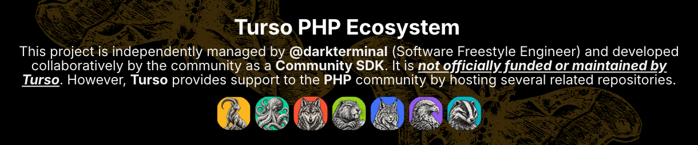
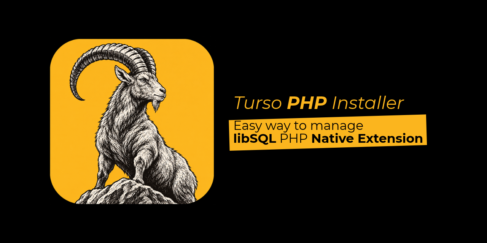

<p align="center">
  <a href="https://discord.gg/9eAaMnJtfY">
    
  </a>
</p>

<p align="center">
  
</p>

<h1 align="center">Turso PHP Installer</h1>
<p align="center">
  A Composer package and Laravel Zero CLI that installs the native <a href="https://github.com/tursodatabase/turso-client-php">libSQL PHP extension</a> on Linux and macOS.
</p>

<p align="center">
  <a href="LICENSE"></a>
  <a href="https://github.com/darkterminal/turso-php-installer/releases"></a>
  <a href="https://packagist.org/packages/darkterminal/turso-php-installer"></a>
  <a href="https://github.com/darkterminal/turso-php-installer/graphs/contributors"></a>
</p>

---

## Overview

**turso-php-installer** downloads the prebuilt [libSQL extension](https://github.com/tursodatabase/turso-client-php) for your PHP runtime and wires it into `php.ini`. It also ships local development helpers: database tokens, server certificates and local `sqld` environments.

- Installs the NTS or TS build matching your PHP version
- Stable releases only, from `tursodatabase/turso-client-php`
- Interactive and non-interactive modes
- Laravel Sail stubs with a fail-hard extension preflight

---

## Supported Versions

| PHP Versions | Build Versions |
| ------------ | -------------- |
| 8.2          | TS / NTS       |
| 8.3          | TS / NTS       |
| 8.4          | TS / NTS       |
| 8.5          | TS / NTS       |

**TS** = Thread Safe, **NTS** = Non Thread Safe

Supported on Linux (`x86_64`, `arm64`) and macOS. On Windows, use WSL or download the extension binary from the [extension releases](https://github.com/tursodatabase/turso-client-php/releases).

The CLI itself requires PHP 8.2 or newer. PHP 8.1 support was dropped; `--php-version=8.1` is rejected.

---

## Installation

```bash
composer global require darkterminal/turso-php-installer
```

Add the Composer global bin directory to your `PATH`:

```bash
export PATH="$(composer config --global home)/vendor/bin:$PATH"
```

Install interactively:

```bash
turso-php-installer install
```

Or non-interactively (example for PHP 8.3):

```bash
turso-php-installer install -n --php-version=8.3
```

Custom `php.ini` and extension directory:

```bash
turso-php-installer install -n --php-version=8.3 \
  --php-ini=/etc/php/8.3/cli/php.ini \
  --extension-dir=/path/to/extensions
```

Verify the extension is loaded:

```bash
php -m | grep libsql
```

Other commands: `uninstall`, `update` (extension only, not the CLI), `version`, `token:*`, `server:*`, `sqld:*`. Run `turso-php-installer list` for the full surface.

---

## Documentation

Full documentation is published on GitHub Pages: **<https://darkterminal.github.io/turso-php-installer/>**

- [Getting started](https://darkterminal.github.io/turso-php-installer/user-manual/getting-started/)
- [Install](https://darkterminal.github.io/turso-php-installer/user-manual/install/)
- [Update](https://darkterminal.github.io/turso-php-installer/user-manual/update/)
- [Uninstall](https://darkterminal.github.io/turso-php-installer/user-manual/uninstall/)
- [Local development workflow](https://darkterminal.github.io/turso-php-installer/user-manual/local-development-workflow/)
- [Tokens & local development](https://darkterminal.github.io/turso-php-installer/user-manual/tokens/)
- [Server certificates](https://darkterminal.github.io/turso-php-installer/user-manual/server-certificates/)
- [sqld local environments](https://darkterminal.github.io/turso-php-installer/user-manual/sqld/)
- [Laravel Sail guide](https://darkterminal.github.io/turso-php-installer/user-manual/laravel-sail/)

Canonical Sail stubs live in [`stubs/sail/`](stubs/sail/README.md).

---

## Development

```bash
composer install
vendor/bin/pest
bash -n stubs/sail/run_turso stubs/sail/sail-entrypoint
python3 scripts/check_docs.py
```

---

## Community & Support

- Report issues on [GitHub Issues](https://github.com/darkterminal/turso-php-installer/issues)
- Sponsor via [GitHub Sponsors](https://github.com/sponsors/darkterminal) or [Saweria](https://saweria.co/darkterminal)

---

## License

This project is open-sourced under the [MIT License](LICENSE).
